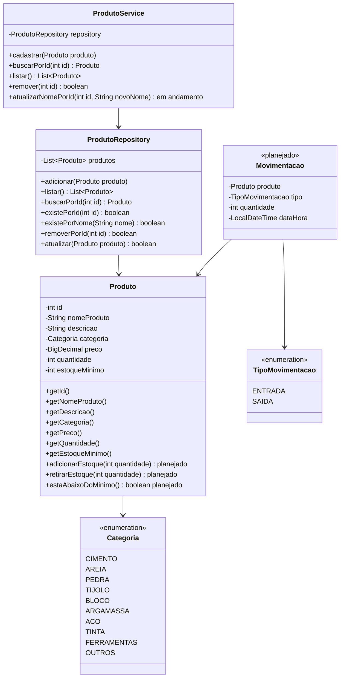

# Controle de Estoque

Aplicação de console em Java para cadastrar materiais de construção e acompanhar entradas, saídas e níveis de estoque.

> **Status atual (novembro de 2026):** as camadas `model`, `repository` e `service` já possuem o cadastro, a consulta, a listagem e a remoção de produtos, com **14 testes automatizados (JUnit 5)**. A **atualização de produto** (renomear) está em andamento no `ProdutoService`. O `Main` ainda está vazio, portanto **ainda não existe interação pelo console**. Entradas, saídas, estoque mínimo e histórico de movimentações ainda serão implementados.

Este projeto é desenvolvido como um projeto de aprendizagem: cada conceito de Java e engenharia de software é estudado conforme for necessário para construir uma funcionalidade real.

---

## 1. Visão geral

### Problema

Uma loja de materiais de construção precisa acompanhar os produtos disponíveis, suas quantidades e movimentações. Controlar tudo manualmente pode causar divergências, falta de materiais e dificuldade para entender o histórico do estoque.

### Objetivo

Construir gradualmente um sistema que permita:

- Cadastrar e consultar materiais de construção.
- Registrar entradas e saídas.
- Consultar a quantidade atual de cada material.
- Manter um histórico de movimentações.
- Avisar quando o estoque estiver abaixo do mínimo definido.

### Escopo atual

A primeira versão será simples e executada no terminal.

- Os dados serão armazenados em memória.
- Não haverá interface gráfica ou web.
- Não haverá login ou múltiplos usuários.
- O banco de dados será introduzido posteriormente.
- As categorias são representadas por um `enum`.

---

## 2. Tecnologias e ambiente

| Item | Escolha atual |
|---|---|
| Linguagem | Java |
| Build | Maven |
| Interface | Console/terminal (ainda não implementada) |
| Armazenamento atual | Memória (`ArrayList`) |
| Testes automatizados | JUnit 5 (`junit-jupiter` 5.14.2) com `maven-surefire-plugin` 3.5.4 |
| Persistência | Planejada para etapa futura |
| Controle de versão | Git |

### Configuração Maven atual

O `pom.xml` define:

- `groupId`: `com.vitor.estoque`
- `artifactId`: `Controle-estoque`
- `version`: `1.0-SNAPSHOT`
- `maven.compiler.release`: `26`
- `project.build.sourceEncoding`: `UTF-8`

É necessário um **JDK compatível com a versão 26**, ou o valor de `maven.compiler.release` deve ser ajustado para a versão instalada.

---

## 3. Estado atual do código

A estrutura existente é:

```text
Controle-estoque/
├── pom.xml
├── README.md
└── src/
    ├── main/java/com/vitor/estoque/
    │   ├── Main.java
    │   ├── model/
    │   │   ├── Produto.java
    │   │   └── Categoria.java
    │   ├── repository/
    │   │   └── ProdutoRepository.java
    │   └── service/
    │       └── ProdutoService.java
    └── test/java/com/vitor/estoque/
        ├── repository/
        │   └── ProdutoRepositoryTest.java
        └── service/
            └── ProdutoServiceTest.java
```

### `Main.java`

A classe principal existe, mas o método `main` está vazio: o menu do console e a criação/conexão dos componentes (`ProdutoRepository` e `ProdutoService`) ainda não foram implementados.

### `Produto.java`

Representa um material de construção dentro do sistema.

| Atributo | Tipo | Característica |
|---|---|---|
| `id` | `int` | Identificador imutável |
| `nomeProduto` | `String` | Nome obrigatório e imutável |
| `descricao` | `String` | Descrição obrigatória e imutável |
| `categoria` | `Categoria` | Categoria imutável |
| `preco` | `BigDecimal` | Preço imutável |
| `quantidade` | `int` | Quantidade que pode ser alterada |
| `estoqueMinimo` | `int` | Limite mínimo imutável |

A classe possui construtor com validações, getters para todos os atributos, `BigDecimal` para valores monetários e `trim()` nos campos de nome e descrição.

#### Validações implementadas

| Atributo | Regra |
|---|---|
| `id` | Deve ser maior que zero |
| `nomeProduto` | Não pode ser nulo ou vazio |
| `descricao` | Não pode ser nula ou vazia |
| `categoria` | Não pode ser nula |
| `preco` | Não pode ser nulo ou negativo |
| `quantidade` | Não pode ser negativa |
| `estoqueMinimo` | Não pode ser negativo |

As validações usam `IllegalArgumentException`. A quantidade e o estoque mínimo podem ser zero.

**Ainda não implementado em `Produto`:**

- Métodos para adicionar ou retirar quantidade do estoque (hoje a quantidade só é definida no construtor).
- Verificação de estoque abaixo do mínimo.

Como quase todos os campos são imutáveis, alterar um dado (por exemplo, o nome) exige criar uma nova instância de `Produto` com o mesmo `id` e substituí-la no repositório.

### `Categoria.java`

Enum com as categorias padronizadas: `CIMENTO`, `AREIA`, `PEDRA`, `TIJOLO`, `BLOCO`, `ARGAMASSA`, `ACO`, `TINTA`, `FERRAMENTAS` e `OUTROS`.

### `ProdutoRepository.java`

Gerencia o armazenamento e a recuperação dos produtos em uma coleção em memória e **não aplica regras de negócio**:

```java
private final List<Produto> produtos = new ArrayList<>();
```

A coleção é privada, portanto outras classes não a manipulam diretamente.

#### Métodos implementados

| Método | Responsabilidade | Retorno |
|---|---|---|
| `adicionar(Produto produto)` | Adiciona um produto à coleção | `void` |
| `listar()` | Retorna uma visão não modificável da lista | `List<Produto>` |
| `buscarPorId(int id)` | Busca um produto pelo identificador | `Produto` ou `null` |
| `existePorId(int id)` | Verifica se existe um produto com o ID informado | `boolean` |
| `existePorNome(String nome)` | Verifica se existe produto com o nome informado (comparação com `trim().toLowerCase()`); lança `IllegalArgumentException` se o nome for `null` | `boolean` |
| `removerPorId(int id)` | Remove um produto pelo identificador | `boolean` |
| `atualizar(Produto produto)` | Substitui o produto de mesmo `id` na coleção; lança `IllegalArgumentException` se o produto for `null` | `boolean` (`false` se o ID não existir) |

As buscas por ID e por nome percorrem a coleção, portanto têm complexidade linear, O(n).

#### Limitações atuais

- Os dados existem somente enquanto o programa está em execução.
- `adicionar()` não verifica duplicidade; essa regra fica no `ProdutoService`.
- A comparação de nomes usa `toLowerCase()` sem `Locale` (decisão de adiar `Locale.ROOT`).
- Ainda não existe persistência em arquivo ou banco de dados.

### `ProdutoService.java`

Concentra as regras de negócio e recebe o `ProdutoRepository` por construtor (injeção de dependência).

#### Métodos implementados

| Método | Comportamento | Erros |
|---|---|---|
| `ProdutoService(ProdutoRepository repository)` | Guarda a referência ao repositório | — |
| `cadastrar(Produto produto)` | Valida produto nulo, **ID duplicado (RN01)** e **nome duplicado**; se válido, chama `repository.adicionar` | `IllegalArgumentException` |
| `buscarPorId(int id)` | Delega ao repositório | `IllegalArgumentException` se o ID não existir |
| `listar()` | Delega ao repositório | — |
| `remover(int id)` | Delega ao repositório | Retorna `false` se não encontrado (sem exceção) |

#### Em andamento

`atualizarNomePorId(int id, String novoNome)` está **iniciado, mas incompleto**: o método declara retorno `boolean`, valida apenas o novo nome e ainda não possui o restante da lógica nem o `return`. Enquanto não for concluído, o código de `main` **não compila**. Conforme o cronograma, a implementação deve:

1. Verificar se o produto existe.
2. Normalizar o novo nome e garantir unicidade em **outro** produto, permitindo manter o próprio nome (ajuste necessário em relação ao `existePorNome` atual).
3. Criar um novo `Produto` com o mesmo `id` e os demais campos copiados.
4. Chamar `repository.atualizar(novoProduto)`.

### Testes automatizados

| Classe | Testes | Cobertura atual |
|---|---|---|
| `ProdutoRepositoryTest` | 5 | adicionar, buscar por ID, existência (verdadeiro e falso) e remover |
| `ProdutoServiceTest` | 9 | cadastro válido, produto nulo, ID duplicado, nome duplicado, busca existente e inexistente, listagem, remoção existente e inexistente |

**Ainda sem testes:** `existePorNome` e `atualizar` no repositório, a atualização no service, e a classe `Produto` (validações do construtor).

---

## 4. Requisitos do sistema

### Requisitos funcionais

| ID | Requisito | Prioridade | Estado |
|---|---|---|---|
| RF01 | Cadastrar material com nome, descrição, categoria, preço e estoque mínimo | Essencial | Parcial (service e testes prontos; falta o console) |
| RF02 | Listar materiais cadastrados | Essencial | Parcial (service e testes prontos; falta o console) |
| RF03 | Buscar material pelo identificador | Essencial | Parcial (service e testes prontos; falta o console) |
| RF04 | Registrar entrada de estoque | Essencial | Planejado |
| RF05 | Registrar saída de estoque | Essencial | Planejado |
| RF06 | Consultar histórico de movimentações | Desejável | Planejado |
| RF07 | Listar materiais abaixo do estoque mínimo | Desejável | Planejado |
| RF08 | Filtrar materiais por categoria | Desejável | Planejado |
| RF09 | Editar e remover materiais | Desejável | Parcial (remoção pronta no service; edição em andamento) |

### Requisitos não funcionais

| ID | Requisito | Estado |
|---|---|---|
| RNF01 | O sistema deverá ser executado em um ambiente compatível com a versão Java configurada. | Em vigor |
| RNF02 | A interface do console não deverá conter as regras principais de negócio. | Respeitado (regras no service) |
| RNF03 | As regras de negócio deverão ser testáveis. | Atendido para cadastro, busca, listagem e remoção |
| RNF04 | As mensagens de erro deverão ser claras. | Em vigor |
| RNF05 | Valores monetários deverão utilizar `BigDecimal`. | Atendido |
| RNF06 | O código deverá ser organizado e fácil de manter. | Em vigor |

---

## 5. Regras de negócio

| ID | Regra | Estado |
|---|---|---|
| RN01 | Cada material deverá possuir um identificador único. | Implementada e testada no `ProdutoService` |
| RN02 | O nome do material será obrigatório. | Implementada no modelo |
| RN03 | A descrição será obrigatória. | Implementada no modelo |
| RN04 | O preço não poderá ser nulo nem negativo. | Implementada no modelo |
| RN05 | O estoque mínimo não poderá ser negativo. | Implementada no modelo |
| RN06 | A quantidade em estoque nunca poderá ficar negativa. | Parcial, validação inicial no construtor |
| RN07 | A quantidade de uma movimentação deverá ser maior que zero. | Planejada |
| RN08 | Um material deverá possuir uma categoria válida. | Implementada no modelo |
| RN09 | Só será possível movimentar materiais cadastrados. | Planejada |
| RN10 | Toda entrada ou saída deverá gerar um registro de movimentação com data e hora. | Planejada |
| RN11 | O nome do material deverá ser único (comparação sem diferenciar maiúsculas/minúsculas e sem espaços nas pontas). | Implementada e testada no cadastro; falta tratar a atualização |

---

## 6. Modelo de domínio

O diagrama mostra o que já existe e o que está planejado. Itens marcados como planejados ainda não existem no código.



### Observações sobre o modelo

- `Produto`, `Categoria`, `ProdutoRepository` e `ProdutoService` existem no código.
- `Movimentacao` e `TipoMovimentacao` ainda serão criados.
- A situação de estoque baixo deverá ser calculada a partir da quantidade atual e do estoque mínimo, evitando armazenar uma informação que pode ficar desatualizada.

---

## 7. Arquitetura

O projeto utiliza uma arquitetura em camadas:

```text
Main
  |
  v
Service
  |
  v
Repository
  |
  v
Coleção em memória (ArrayList)
```

O modelo é utilizado pelas diferentes camadas para representar os dados do domínio.

| Camada | Responsabilidade | Estado |
|---|---|---|
| `Main` | Inicialização e interação pelo console | Esqueleto vazio |
| `service` | Regras de negócio e coordenação das operações | Implementada (cadastro, busca, listagem, remoção); atualização em andamento |
| `repository` | Armazenamento e recuperação dos dados | Implementada |
| `model` | Entidades e tipos do domínio | Implementada |
| `exception` | Exceções específicas do sistema, se necessárias | Planejada (hoje se usa `IllegalArgumentException`) |

### Comunicação entre Service e Repository

O `ProdutoService` recebe o `ProdutoRepository` pelo construtor (injeção de dependência) e usa apenas seus métodos públicos, sem acessar a coleção privada. A criação e a conexão desses objetos ficará sob responsabilidade do `Main`.

Fluxo típico previsto: o console lê os dados → chama o Service → o Service valida as regras → consulta ou atualiza via Repository → o Service retorna o resultado ou lança exceção → o console exibe a mensagem.

### Evolução da persistência

Atualmente o Repository usa `ArrayList`. Posteriormente poderá ser adaptado para um banco de dados, mantendo as responsabilidades separadas para que a forma de armazenamento evolua sem alterar o `Produto` nem concentrar operações de banco nas regras de negócio.

---

## 8. Roadmap de desenvolvimento

- [x] **Etapa 1 — Modelo de produto:** criar `Produto`, atributos, construtor, getters e validações.
- [x] **Etapa 2 — Categorias:** implementar o enum `Categoria`.
- [x] **Etapa 3 — Armazenamento em memória:** criar `ProdutoRepository` utilizando `ArrayList`.
- [x] **Etapa 4 — Operações do repositório:** adicionar, listar, buscar por ID, verificar existência (ID e nome), remover por ID e atualizar.
- [x] **Etapa 5 — Testes automatizados:** configurar JUnit e testar o Repository.
- [x] **Etapa 6 — Service (contrato base):** `cadastrar`, `buscarPorId`, `listar` e `remover`, com ID e nome duplicados rejeitados e testes.
- [ ] **Etapa 7 — Atualização de produto** *(em andamento)*: concluir `atualizarNomePorId`, permitir manter o próprio nome e testar os cenários (produto existente, ID inexistente, nome duplicado em outro produto, nome igual ao próprio).
- [ ] **Etapa 8 — Entrada e saída de estoque:** alterar a quantidade validando valores e sem permitir estoque negativo.
- [ ] **Etapa 9 — Estoque mínimo:** identificar e avisar sobre materiais abaixo do limite.
- [ ] **Etapa 10 — Histórico:** criar `Movimentacao`, registrar entradas e saídas com data e hora e consultar por material.
- [ ] **Etapa 11 — Cadastro e consulta pelo console:** implementar o menu no `Main` e conectar às camadas.
- [ ] **Etapa 12 — Filtros:** filtrar materiais por categoria.
- [ ] **Etapa 13 — Persistência:** estudar armazenamento permanente e integrar o projeto a um banco de dados.
- [ ] **Etapa 14 — Refinamento:** melhorar mensagens, documentação, validações e organização.

A ordem poderá ser ajustada quando surgirem necessidades técnicas.

---

## 9. Como executar

Pré-requisitos: JDK compatível com a versão configurada no `pom.xml` (atualmente 26) e Maven.

Na raiz do projeto:

```bash
mvn clean compile   # compila o projeto
mvn test            # executa os testes automatizados
```

Atualmente o `Main` não possui fluxo de interação: a compilação e os testes são a forma de verificar o código existente. A compilação só será concluída com sucesso depois que `atualizarNomePorId` estiver finalizado.

---

## 10. Decisões de projeto

| Decisão | Motivo |
|---|---|
| Começar com armazenamento em memória | Aprender as regras de negócio antes de introduzir persistência. |
| Utilizar `BigDecimal` para preço | Evitar problemas de precisão de ponto flutuante em valores monetários. |
| Utilizar `enum` para categorias | Representar um conjunto fechado de categorias de forma padronizada. |
| Utilizar `List` com implementação `ArrayList` | Trabalhar com uma coleção dinâmica de produtos. |
| Manter a coleção privada no Repository | Proteger o acesso direto à estrutura interna de armazenamento. |
| Retornar uma lista não modificável em `listar()` | Evitar alterações externas na coleção por meio do retorno do método. |
| Repository sem regras de negócio | Duplicidade e existência são decididas no Service, que consulta o Repository. |
| Nome de produto único, comparado com `trim().toLowerCase()` | Evitar cadastros duplicados que diferem só por caixa ou espaços. |
| `buscarPorId` do Service lança exceção; o do Repository retorna `null` | O Service cancela a operação quando o produto não existe; o Repository apenas informa a ausência. |
| `remover` retorna `boolean` em vez de lançar exceção | Remover algo inexistente não é considerado erro. |
| `Produto` imutável (exceto `quantidade`) | Atualizar exige nova instância, substituída via `repository.atualizar`. |
| Adiar `Locale.ROOT` em comparações de nome | Decidir apenas se for necessário; ver contrato do Service. |
| Utilizar injeção de dependência por construtor | Permitir que o Service receba o Repository que utilizará e facilitar os testes. |
| Separar regras de negócio da interface | Facilitar manutenção e testes. |
| Adicionar banco de dados posteriormente | Introduzir SQL e persistência quando as operações básicas estiverem consolidadas. |

---

## 11. Método de aprendizagem

Este projeto é o principal material de estudo de Java e engenharia de software.

Para cada funcionalidade:

1. Entender o problema que precisa ser resolvido.
2. Identificar os conceitos necessários.
3. Planejar uma solução.
4. Implementar o código.
5. Revisar, testar e corrigir.
6. Refatorar quando houver motivo.
7. Atualizar esta documentação conforme o projeto evoluir.

O objetivo não é apenas fazer o programa funcionar, mas entender as decisões tomadas e desenvolver autonomia para criar outros sistemas e especificar soluções com precisão.