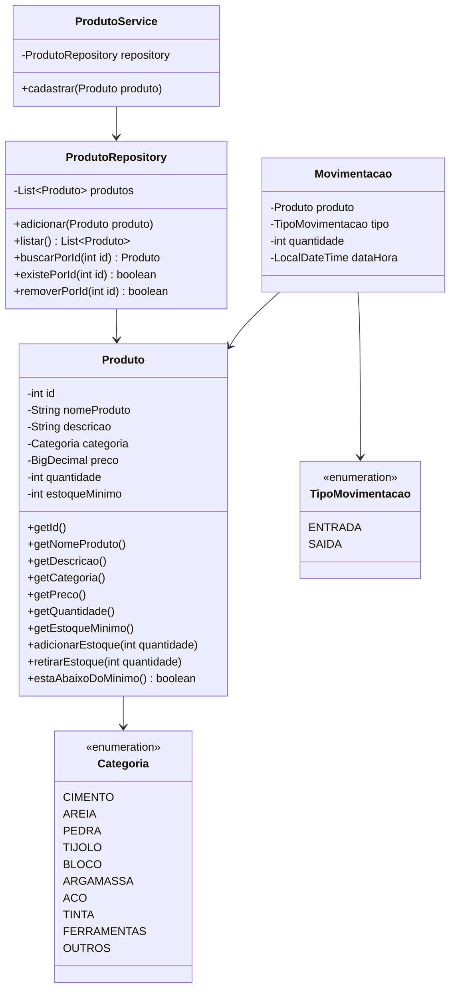

# Controle de Estoque

Aplicação de console em Java para cadastrar materiais de construção e acompanhar entradas, saídas e níveis de estoque.

> **Status atual:** modelo `Produto` e enum `Categoria` concluídos. O `ProdutoRepository` já possui operações de armazenamento e consulta em memória. O `Service`, os testes automatizados e o fluxo de interação pelo console ainda serão implementados.

Este projeto será desenvolvido como um projeto de aprendizagem: cada conceito de Java e engenharia de software será estudado conforme for necessário para construir uma funcionalidade real.

---

## 1. Visão geral

### Problema

Uma loja de materiais de construção precisa acompanhar os produtos disponíveis, suas quantidades e movimentações. Controlar tudo manualmente pode causar divergências, falta de materiais e dificuldade para entender o histórico do estoque.

### Objetivo

Construir gradualmente um sistema que permita:

- Cadastrar e consultar materiais de construção.
- Registrar entradas e saídas.
- Consultar a quantidade atual de cada material.
- Manter um histórico de movimentações.
- Avisar quando o estoque estiver abaixo do mínimo definido.

### Escopo atual

A primeira versão será simples e executada no terminal.

- Os dados serão armazenados em memória.
- Não haverá interface gráfica ou web.
- Não haverá login ou múltiplos usuários.
- O banco de dados será introduzido posteriormente.
- As categorias serão representadas inicialmente por um `enum`.

---

## 2. Tecnologias e ambiente

| Item | Escolha atual |
|---|---|
| Linguagem | Java |
| Build | Maven |
| Interface | Console/terminal |
| Armazenamento atual | Memória (`ArrayList`) |
| Testes automatizados | JUnit planejado |
| Persistência | Planejada para etapa futura |
| IDE | Ambiente de desenvolvimento local |

### Configuração Maven atual

O `pom.xml` existente define:

- `groupId`: `com.vitor.estoque`
- `artifactId`: `Controle-estoque`
- `version`: `1.0-SNAPSHOT`
- `maven.compiler.source`: `26`
- `maven.compiler.target`: `26`

A versão do Java configurada no Maven deve ser compatível com o JDK instalado no computador.

---

## 3. Estado atual do código

A estrutura existente é:

```text
Controle-estoque/
├── pom.xml
├── README.md
└── src/
    ├── main/
    │   └── java/
    │       └── com/vitor/estoque/
    │           ├── Main.java
    │           ├── model/
    │           │   ├── Produto.java
    │           │   └── Categoria.java
    │           └── repository/
    │               └── ProdutoRepository.java
    └── test/
        └── java/
```

O diretório de testes ainda não possui testes implementados.

### `Main.java`

A classe principal existe, mas o fluxo de execução e o menu do console ainda não foram implementados.

Futuramente, será responsável por iniciar e conectar os componentes da aplicação.

### `Produto.java`

A classe `Produto` representa um material de construção dentro do sistema.

Seus atributos são:

| Atributo | Tipo | Característica |
|---|---|---|
| `id` | `int` | Identificador imutável |
| `nomeProduto` | `String` | Nome obrigatório e imutável |
| `descricao` | `String` | Descrição obrigatória e imutável |
| `categoria` | `Categoria` | Categoria imutável |
| `preco` | `BigDecimal` | Preço imutável |
| `quantidade` | `int` | Quantidade que pode ser alterada |
| `estoqueMinimo` | `int` | Limite mínimo imutável |

A classe possui:

- Construtor com validações.
- Métodos getters para seus atributos.
- Uso de `BigDecimal` para representar valores monetários.
- Uso de `trim()` nos campos de nome e descrição.

#### Validações implementadas

| Atributo | Regra |
|---|---|
| `id` | Deve ser maior que zero |
| `nomeProduto` | Não pode ser nulo ou vazio |
| `descricao` | Não pode ser nula ou vazia |
| `categoria` | Não pode ser nula |
| `preco` | Não pode ser nulo ou negativo |
| `quantidade` | Não pode ser negativa |
| `estoqueMinimo` | Não pode ser negativo |

As validações do construtor utilizam `IllegalArgumentException` para rejeitar valores inválidos.

A descrição é obrigatória. A quantidade e o estoque mínimo podem ser zero.

**Ainda não implementado em `Produto`:**

- Métodos específicos para adicionar ou retirar quantidade do estoque.
- Verificação de estoque abaixo do mínimo.

### `Categoria.java`

O enum `Categoria` está implementado e representa as categorias padronizadas de materiais de construção.

As categorias são:

- `CIMENTO`
- `AREIA`
- `PEDRA`
- `TIJOLO`
- `BLOCO`
- `ARGAMASSA`
- `ACO`
- `TINTA`
- `FERRAMENTAS`
- `OUTROS`

O uso de `enum` permite trabalhar com um conjunto centralizado de categorias, evitando valores inconsistentes espalhados pela aplicação.

### `ProdutoRepository.java`

O `ProdutoRepository` foi criado para gerenciar o armazenamento e a recuperação dos produtos.

Atualmente, utiliza uma coleção em memória:

```java
private final List<Produto> produtos = new ArrayList<>();
```

A interface `List` define o contrato da coleção, enquanto `ArrayList` é a implementação utilizada.

A coleção é privada, portanto outras classes não podem manipulá-la diretamente.

#### Métodos implementados

| Método | Responsabilidade | Retorno |
|---|---|---|
| `adicionar(Produto produto)` | Adiciona um produto à coleção | `void` |
| `listar()` | Retorna uma visão não modificável da lista | `List<Produto>` |
| `buscarPorId(int id)` | Busca um produto pelo identificador | `Produto` ou `null` |
| `existePorId(int id)` | Verifica se existe um produto com o ID informado | `boolean` |
| `removerPorId(int id)` | Remove um produto pelo identificador | `boolean` |

O método `listar()` utiliza `Collections.unmodifiableList()` para impedir que outras classes adicionem ou removam elementos diretamente pela lista retornada.

A busca por ID utiliza uma iteração sobre a coleção. Portanto, sua complexidade é linear, \(O(n)\).

#### Limitações atuais

- Os dados existem somente enquanto o programa está em execução.
- A coleção é reinicializada vazia quando o programa é iniciado novamente.
- O método `adicionar()` ainda não verifica regras de negócio, como a duplicidade de IDs.
- Ainda não existe persistência em arquivo ou banco de dados.

---

## 4. Requisitos do sistema

Os requisitos abaixo representam o comportamento planejado e o estado atual de implementação.

### Requisitos funcionais

| ID | Requisito | Prioridade | Estado |
|---|---|---|---|
| RF01 | Cadastrar material com nome, descrição, categoria, preço e estoque mínimo | Essencial | Parcial |
| RF02 | Listar materiais cadastrados | Essencial | Parcial |
| RF03 | Buscar material pelo identificador | Essencial | Parcial |
| RF04 | Registrar entrada de estoque | Essencial | Planejado |
| RF05 | Registrar saída de estoque | Essencial | Planejado |
| RF06 | Consultar histórico de movimentações | Desejável | Planejado |
| RF07 | Listar materiais abaixo do estoque mínimo | Desejável | Planejado |
| RF08 | Filtrar materiais por categoria | Desejável | Planejado |
| RF09 | Editar e remover materiais | Desejável | Parcial |

**Observação:** RF01, RF02 e RF03 possuem parte de sua estrutura implementada no modelo e no repositório, mas ainda não estão disponíveis como funcionalidades completas para o usuário pelo console.

### Requisitos não funcionais

| ID | Requisito |
|---|---|
| RNF01 | O sistema deverá ser executado em um ambiente compatível com a versão Java configurada. |
| RNF02 | A interface do console não deverá conter as regras principais de negócio. |
| RNF03 | As regras de negócio deverão ser testáveis. |
| RNF04 | As mensagens de erro deverão ser claras. |
| RNF05 | Valores monetários deverão utilizar `BigDecimal`. |
| RNF06 | O código deverá ser organizado e fácil de manter. |

---

## 5. Regras de negócio

| ID | Regra | Estado |
|---|---|---|
| RN01 | Cada material deverá possuir um identificador único. | Pendente no cadastro |
| RN02 | O nome do material será obrigatório. | Implementada no modelo |
| RN03 | A descrição será obrigatória. | Implementada no modelo |
| RN04 | O preço não poderá ser nulo nem negativo. | Implementada no modelo |
| RN05 | O estoque mínimo não poderá ser negativo. | Implementada no modelo |
| RN06 | A quantidade em estoque nunca poderá ficar negativa. | Parcial, validação inicial no modelo |
| RN07 | A quantidade de uma movimentação deverá ser maior que zero. | Planejada |
| RN08 | Um material deverá possuir uma categoria válida. | Implementada no modelo |
| RN09 | Só será possível movimentar materiais cadastrados. | Planejada |
| RN10 | Toda entrada ou saída deverá gerar um registro de movimentação com data e hora. | Planejada |

As regras serão implementadas gradualmente e protegidas por testes quando a estrutura de testes for adicionada.

---

## 6. Modelo de domínio planejado

O modelo abaixo representa a direção futura do projeto. Nem todas as classes e operações já existem no código.



### Observações sobre o modelo

- `Produto` está implementado.
- `Categoria` está implementado.
- `ProdutoRepository` está implementado para armazenamento em memória.
- `ProdutoService` ainda será criado.
- `Movimentacao` e `TipoMovimentacao` ainda serão criados.
- A situação de estoque baixo deverá ser calculada a partir da quantidade atual e do estoque mínimo, evitando armazenar uma informação que pode ficar desatualizada.

---

## 7. Arquitetura

O projeto está sendo desenvolvido para utilizar uma arquitetura em camadas:

```text
Main
  |
  v
Service
  |
  v
Repository
  |
  v
Coleção em memória (ArrayList)
```

O modelo é utilizado pelas diferentes camadas para representar os dados do domínio.

| Camada | Responsabilidade | Estado |
|---|---|---|
| `Main` | Inicialização e interação pelo console | Parcial |
| `service` | Regras de negócio e coordenação das operações | Planejada |
| `repository` | Armazenamento e recuperação dos dados | Implementada |
| `model` | Entidades e tipos do domínio | Implementada |
| `exception` | Exceções específicas do sistema, se necessárias | Planejada |

### Comunicação entre Service e Repository

O Service receberá uma referência para o Repository por meio do construtor, utilizando injeção de dependência.

Dessa forma, o Service poderá utilizar os métodos públicos do Repository para consultar, adicionar e remover produtos, sem acessar diretamente a coleção privada.

Exemplo conceitual:

```java
public class ProdutoService {

    private final ProdutoRepository repository;

    public ProdutoService(ProdutoRepository repository) {
        this.repository = repository;
    }
}
```

A criação e conexão desses objetos ficará sob responsabilidade da inicialização da aplicação.

### Evolução da persistência

Atualmente, o Repository utiliza `ArrayList`. Posteriormente, poderá ser adaptado para utilizar um banco de dados.

A intenção é manter as responsabilidades separadas para que a forma de armazenamento possa evoluir sem alterar o significado da classe `Produto` ou concentrar operações de banco de dados nas regras de negócio.

---

## 8. Roadmap de desenvolvimento

- [x] **Etapa 1 — Modelo de produto:** criar `Produto`, atributos, construtor, getters e validações.
- [x] **Etapa 2 — Categorias:** implementar o enum `Categoria`.
- [x] **Etapa 3 — Armazenamento em memória:** criar `ProdutoRepository` utilizando `ArrayList`.
- [x] **Etapa 4 — Operações básicas do repositório:** adicionar, listar, buscar por ID, verificar existência e remover por ID.
- [ ] **Etapa 5 — Testes automatizados:** configurar JUnit e testar os métodos do Repository.
- [ ] **Etapa 6 — Service:** implementar regras de negócio, como impedir cadastro com ID duplicado.
- [ ] **Etapa 7 — Cadastro e consulta pelo console:** conectar o fluxo de interação às camadas da aplicação.
- [ ] **Etapa 8 — Entrada de estoque:** aumentar a quantidade e registrar a movimentação.
- [ ] **Etapa 9 — Saída de estoque:** reduzir a quantidade sem permitir estoque negativo.
- [ ] **Etapa 10 — Estoque mínimo:** identificar e avisar sobre materiais abaixo do limite.
- [ ] **Etapa 11 — Histórico:** consultar movimentações por material.
- [ ] **Etapa 12 — Filtros:** filtrar materiais por categoria.
- [ ] **Etapa 13 — Persistência:** estudar armazenamento permanente e integrar o projeto a um banco de dados.
- [ ] **Etapa 14 — Refinamento:** melhorar mensagens, documentação, validações e organização.

A ordem poderá ser ajustada quando surgirem necessidades técnicas durante a implementação.

---

## 9. Como executar

Na raiz do projeto, execute:

```bash
mvn clean compile
```

Para executar os testes, depois que o JUnit estiver configurado:

```bash
mvn test
```

Atualmente, `Main.java` ainda não possui um fluxo funcional de interação. A compilação pode ser utilizada para verificar a estrutura e o código existente.

---

## 10. Decisões de projeto

| Decisão | Motivo |
|---|---|
| Começar com armazenamento em memória | Aprender as regras de negócio antes de introduzir persistência. |
| Utilizar `BigDecimal` para preço | Evitar problemas de precisão comuns em valores monetários com ponto flutuante. |
| Utilizar `enum` para categorias | Representar um conjunto fechado de categorias de forma padronizada. |
| Utilizar `List` com implementação `ArrayList` | Trabalhar com uma coleção dinâmica de produtos. |
| Manter a coleção privada no Repository | Proteger o acesso direto à estrutura interna de armazenamento. |
| Retornar uma lista não modificável em `listar()` | Evitar alterações externas na coleção por meio do retorno do método. |
| Separar regras de negócio da interface | Facilitar manutenção e testes. |
| Utilizar injeção de dependência por construtor | Permitir que o Service receba o Repository que utilizará. |
| Desenvolver por funcionalidades | Aprender conceitos aplicando-os diretamente ao projeto. |
| Adicionar banco de dados posteriormente | Introduzir SQL e persistência quando as operações básicas estiverem consolidadas. |

---

## 11. Método de aprendizagem

Este projeto será o principal material de estudo de Java e engenharia de software.

Para cada funcionalidade:

1. Entender o problema que precisa ser resolvido.
2. Identificar os conceitos necessários.
3. Planejar uma solução.
4. Implementar o código.
5. Revisar, testar e corrigir.
6. Refatorar quando houver motivo.
7. Atualizar esta documentação conforme o projeto evoluir.

O objetivo não é apenas fazer o programa funcionar, mas entender as decisões tomadas e desenvolver autonomia para criar outros sistemas e especificar soluções com precisão.
