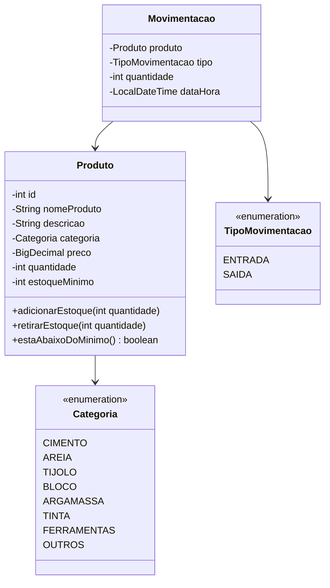

# Controle de Estoque

Aplicação de console em Java para cadastrar materiais de construção e, futuramente, acompanhar entradas e saídas de estoque.

> **Status atual:** projeto iniciado. O modelo `Produto` está criado; o menu, as regras de negócio, os repositórios e as movimentações ainda serão implementados.

Este projeto será desenvolvido como um projeto de aprendizagem: cada conceito de Java e engenharia de software será estudado conforme for necessário para construir uma funcionalidade real.

---

## 1. Visão geral

### Problema

Uma loja de materiais de construção precisa acompanhar os produtos disponíveis, suas quantidades e movimentações. Controlar tudo manualmente pode causar divergências, falta de materiais e dificuldade para entender o histórico do estoque.

### Objetivo

Construir gradualmente um sistema de console que permita:

- Cadastrar e consultar materiais de construção.
- Registrar entradas e saídas.
- Consultar a quantidade atual de cada material.
- Manter um histórico de movimentações.
- Avisar quando o estoque estiver abaixo do mínimo definido.

### Escopo inicial

A primeira versão será simples e executada no terminal.

- Os dados serão armazenados em memória.
- Não haverá interface gráfica ou web.
- Não haverá login ou múltiplos usuários.
- O banco de dados será introduzido posteriormente.
- As categorias serão inicialmente definidas por um `enum`.

---

## 2. Tecnologias e ambiente

| Item | Escolha atual |
|---|---|
| Linguagem | Java |
| Build | Maven |
| Interface | Console/terminal |
| Armazenamento inicial | Memória |
| IDE | A definir conforme o ambiente de desenvolvimento |
| Testes automatizados | Planejados; ainda não configurados |

### Configuração Maven atual

O `pom.xml` existente define:

- `groupId`: `com.vitor.estoque`
- `artifactId`: `Controle-estoque`
- `version`: `1.0-SNAPSHOT`
- `maven.compiler.source`: `26`
- `maven.compiler.target`: `26`

A versão do Java configurada no Maven deve ser compatível com o JDK instalado no computador.

---

## 3. Estado atual do código

A estrutura existente no momento desta documentação é:

```text
Controle-estoque/
├── pom.xml
├── README.md
└── src/
    └── main/
        └── java/
            └── com/vitor/estoque/
                ├── Main.java
                └── model/
                    ├── Produto.java
                    └── Categoria.java
```

### `Main.java`

A classe principal existe, mas o método `main` ainda está vazio. O menu do console será implementado posteriormente.

### `Produto.java`

A classe `Produto` já foi criada e contém os seguintes atributos:

| Atributo | Tipo | Situação |
|---|---|---|
| `id` | `int` | Declarado como `final` |
| `nomeProduto` | `String` | Declarado como `final` |
| `descricao` | `String` | Declarado como `final` |
| `categoria` | `Categoria` | Declarado como `final` |
| `preco` | `BigDecimal` | Declarado como `final` |
| `quantidade` | `int` | Pode ser alterado |
| `estoqueMinimo` | `int` | Declarado como `final` |

A classe possui um construtor e métodos getters.

**Ainda não implementado em `Produto`:**

- Validação dos valores recebidos pelo construtor.
- Métodos para adicionar ou retirar quantidade do estoque.
- Verificação de estoque abaixo do mínimo.
- Regras para impedir quantidades inválidas.

Essas funcionalidades serão implementadas durante o desenvolvimento, conforme as etapas do projeto.

### `Categoria.java`

A classe `Categoria` foi criada como um `enum`, mas ainda está vazia. A proposta é utilizar categorias de materiais de construção, por exemplo:

- `CIMENTO`
- `AREIA`
- `TIJOLO`
- `BLOCO`
- `ARGAMASSA`
- `TINTA`
- `FERRAMENTAS`
- `OUTROS`

Esses valores são **propostos para a próxima etapa** e ainda precisam ser adicionados ao código Java.

---

## 4. Requisitos do sistema

Os requisitos abaixo representam o comportamento planejado, não funcionalidades já concluídas.

### Requisitos funcionais

| ID | Requisito | Prioridade | Estado |
|---|---|---|---|
| RF01 | Cadastrar material com nome, descrição, categoria, preço e estoque mínimo | Essencial | Planejado |
| RF02 | Listar materiais cadastrados | Essencial | Planejado |
| RF03 | Buscar material pelo identificador | Essencial | Planejado |
| RF04 | Registrar entrada de estoque | Essencial | Planejado |
| RF05 | Registrar saída de estoque | Essencial | Planejado |
| RF06 | Consultar histórico de movimentações | Desejável | Planejado |
| RF07 | Listar materiais abaixo do estoque mínimo | Desejável | Planejado |
| RF08 | Filtrar materiais por categoria | Desejável | Planejado |
| RF09 | Editar e remover materiais | Desejável | Planejado |

### Requisitos não funcionais

| ID | Requisito |
|---|---|
| RNF01 | O sistema deverá ser executado em um ambiente compatível com a versão Java configurada. |
| RNF02 | A interface do console não deverá conter as regras principais de negócio. |
| RNF03 | As regras de negócio deverão ser testáveis. |
| RNF04 | As mensagens de erro deverão ser claras. |
| RNF05 | Valores monetários deverão utilizar `BigDecimal`. |
| RNF06 | O código deverá ser organizado e fácil de manter. |

---

## 5. Regras de negócio planejadas

| ID | Regra |
|---|---|
| RN01 | Cada material deverá possuir um identificador único. |
| RN02 | O nome do material será obrigatório. |
| RN03 | A descrição poderá ser opcional. |
| RN04 | O preço não poderá ser nulo nem negativo. |
| RN05 | O estoque mínimo não poderá ser negativo. |
| RN06 | A quantidade em estoque nunca poderá ficar negativa. |
| RN07 | A quantidade de uma movimentação deverá ser maior que zero. |
| RN08 | Um material deverá possuir uma categoria válida. |
| RN09 | Só será possível movimentar materiais cadastrados. |
| RN10 | Toda entrada ou saída deverá gerar um registro de movimentação com data e hora. |

As regras serão implementadas gradualmente e protegidas por testes quando a estrutura de testes for adicionada.

---

## 6. Modelo de domínio planejado

O modelo abaixo representa a direção futura do projeto. Nem todas as classes e operações já existem no código.



### Observações sobre o modelo

- `Produto` já existe parcialmente.
- `Categoria` existe, mas ainda não possui constantes.
- `Movimentacao` e `TipoMovimentacao` ainda serão criados.
- O estado de estoque baixo deverá ser calculado a partir da quantidade atual e do estoque mínimo, evitando armazenar uma informação que pode ficar desatualizada.

---

## 7. Arquitetura planejada

O projeto deverá evoluir para uma arquitetura em camadas:

```text
ui  →  service  →  repository
              ↘
              model
```

| Camada | Responsabilidade | Estado |
|---|---|---|
| `ui` | Menu, leitura de dados e apresentação de resultados | Planejada |
| `service` | Regras de negócio e coordenação das operações | Planejada |
| `repository` | Armazenamento e recuperação dos dados | Planejada |
| `model` | Entidades e tipos do domínio | Iniciada |
| `exception` | Exceções específicas do sistema, se necessárias | Planejada |

A organização será introduzida conforme o projeto crescer. Não é necessário criar todas as camadas antes de existir uma funcionalidade que precise delas.

---

## 8. Roadmap de desenvolvimento

Cada etapa será construída como uma funcionalidade completa, incluindo modelo, regras, armazenamento e interface quando necessário.

- [ ] **Etapa 1 — Categorias e cadastro:** completar o enum de categorias, validar os dados e cadastrar materiais.
- [ ] **Etapa 2 — Listagem e busca:** listar materiais e pesquisar pelo identificador.
- [ ] **Etapa 3 — Armazenamento em memória:** criar uma estrutura para guardar e recuperar os materiais.
- [ ] **Etapa 4 — Entrada de estoque:** aumentar a quantidade e registrar a movimentação.
- [ ] **Etapa 5 — Saída de estoque:** reduzir a quantidade sem permitir estoque negativo.
- [ ] **Etapa 6 — Estoque mínimo:** identificar e avisar sobre materiais abaixo do limite.
- [ ] **Etapa 7 — Histórico:** consultar movimentações por material.
- [ ] **Etapa 8 — Filtros:** filtrar materiais por categoria.
- [ ] **Etapa 9 — Testes automatizados:** configurar JUnit e testar as regras de negócio.
- [ ] **Etapa 10 — Persistência:** salvar os dados em arquivo ou banco de dados.
- [ ] **Etapa 11 — Banco de dados:** estudar SQL e integrar o projeto usando JDBC.
- [ ] **Etapa 12 — Refinamento:** melhorar mensagens, documentação, validações e organização.

A ordem poderá ser ajustada quando surgirem necessidades técnicas durante a implementação.

---

## 9. Como executar

Na raiz do projeto, execute:

```bash
mvn clean compile
```

Para executar os testes, quando eles estiverem configurados:

```bash
mvn test
```

Atualmente, `Main.java` não possui funcionalidades implementadas. Portanto, a compilação pode ser utilizada para verificar a estrutura inicial, mas o sistema ainda não apresenta um menu funcional.

---

## 10. Decisões de projeto

| Decisão | Motivo |
|---|---|
| Começar com armazenamento em memória | Aprender as regras de negócio antes de introduzir persistência. |
| Utilizar `BigDecimal` para preço | Evitar problemas de precisão comuns em valores monetários com ponto flutuante. |
| Utilizar `enum` para categorias inicialmente | Representar um conjunto fechado de categorias de forma simples. |
| Separar regras de negócio da interface | Facilitar manutenção e testes. |
| Desenvolver por funcionalidades | Aprender conceitos aplicando-os diretamente ao projeto. |
| Adicionar banco de dados posteriormente | Introduzir SQL e persistência quando o sistema já tiver regras de negócio funcionando. |

---

## 11. Método de aprendizagem

Este projeto será o principal material de estudo de Java e engenharia de software.

Para cada funcionalidade:

1. Entender o problema que precisa ser resolvido.
2. Identificar os conceitos necessários.
3. Planejar uma solução.
4. Implementar o código.
5. Revisar, testar e corrigir.
6. Refatorar quando houver motivo.
7. Atualizar esta documentação conforme o projeto evoluir.

O objetivo não é apenas fazer o programa funcionar, mas entender as decisões tomadas e desenvolver autonomia para criar outros sistemas.
