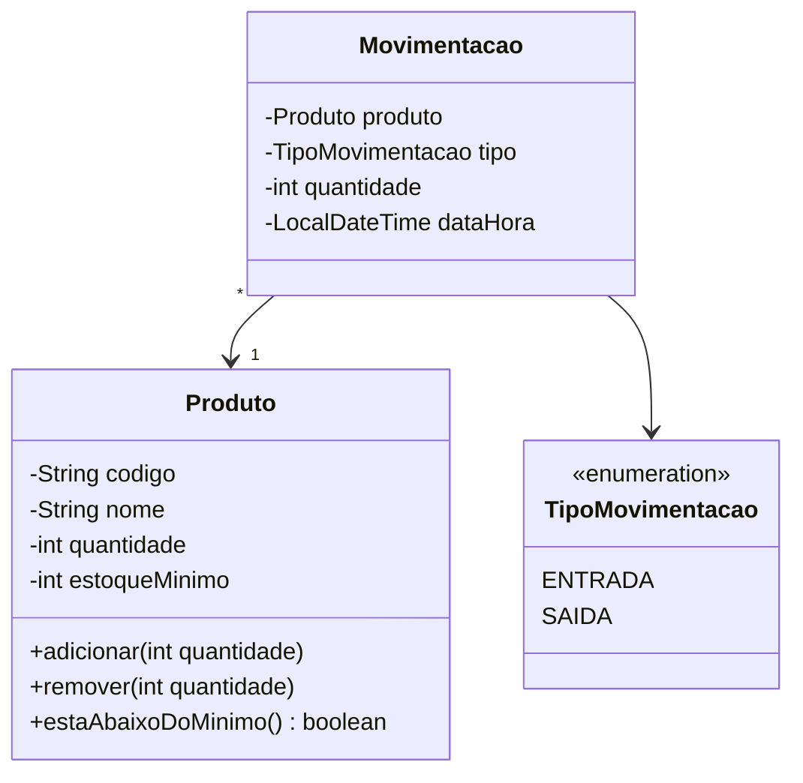

# Controle de Estoque

Aplicação de console em Java para registrar produtos e acompanhar entradas e saídas de estoque. Projeto pessoal criado para praticar Java, Maven e arquitetura em camadas.

> **Status:** em planejamento

---

## 1. Visão geral

### Problema
Pequenos comércios costumam controlar o estoque de cabeça ou em planilhas, o que gera erros de contagem e falta de produtos. Este programa centraliza o cadastro de produtos e o registro das movimentações, mostrando sempre a quantidade atual de cada item.

### Objetivos
- Cadastrar produtos e consultar a quantidade disponível.
- Registrar entradas e saídas de estoque, mantendo o histórico.
- Alertar quando um produto estiver abaixo do estoque mínimo.
- Servir como projeto de aprendizado: código organizado em camadas, com regras de negócio isoladas e testáveis.

### Fora do escopo (por enquanto)
- Interface gráfica ou web
- Múltiplos usuários e login
- Fornecedores, categorias e relatórios avançados
- Integração com banco de dados (a primeira versão guarda os dados em memória)

---

## 2. Tecnologias

| Item | Escolha |
|------|---------|
| Linguagem | Java (versão definida no `pom.xml`) |
| Build | Maven |
| Testes | JUnit 5 |
| Interface | Menu no console |
| Persistência (v1) | Em memória (`List` / `Map`) |

---

## 3. Requisitos

### Funcionais
| ID | Requisito | Prioridade |
|----|-----------|------------|
| RF01 | Cadastrar produto | Essencial |
| RF02 | Listar produtos com a quantidade atual | Essencial |
| RF03 | Registrar entrada de estoque | Essencial |
| RF04 | Registrar saída de estoque | Essencial |
| RF05 | Consultar histórico de movimentações de um produto | Desejável |
| RF06 | Listar produtos abaixo do estoque mínimo | Desejável |
| RF07 | Editar e remover produto | Desejável |

### Não funcionais
| ID | Requisito |
|----|-----------|
| RNF01 | O sistema deve rodar em qualquer computador com Java instalado |
| RNF02 | As regras de negócio devem ficar fora da camada de interface |
| RNF03 | As regras de negócio devem ter testes automatizados |
| RNF04 | Mensagens de erro devem ser claras para o usuário |

### Regras de negócio
| ID | Regra |
|----|-------|
| RN01 | O código do produto deve ser único |
| RN02 | A quantidade em estoque nunca pode ficar negativa |
| RN03 | A quantidade de uma movimentação deve ser maior que zero |
| RN04 | Toda entrada ou saída gera um registro de movimentação com data e hora |
| RN05 | Um produto só pode receber movimentações se estiver cadastrado |

---

## 4. Histórias de usuário

Formato: **Como** [quem], **quero** [o quê], **para** [por quê].

### US01 — Cadastrar produto (RF01)
**Como** dono da loja, **quero** cadastrar um produto com código, nome e estoque mínimo, **para** poder controlá-lo no sistema.

**Critérios de aceite**
- [ ] Dado um código ainda não usado, o produto é cadastrado com quantidade inicial 0
- [ ] Se o código já existir, o sistema recusa e informa o motivo
- [ ] Nome vazio ou estoque mínimo negativo são recusados

### US02 — Listar produtos (RF02)
**Como** dono da loja, **quero** ver a lista de produtos com as suas quantidades, **para** saber o que tenho disponível.

**Critérios de aceite**
- [ ] A lista mostra código, nome, quantidade atual e estoque mínimo
- [ ] Se não houver produtos, o sistema informa que a lista está vazia

### US03 — Registrar entrada (RF03)
**Como** dono da loja, **quero** registrar a entrada de um produto, **para** manter o estoque atualizado quando recebo mercadoria.

**Critérios de aceite**
- [ ] A quantidade informada é somada ao estoque do produto
- [ ] Um registro de movimentação do tipo ENTRADA é criado
- [ ] Quantidade igual ou menor que zero é recusada
- [ ] Código de produto inexistente é recusado

### US04 — Registrar saída (RF04)
**Como** dono da loja, **quero** registrar a saída de um produto, **para** refletir as vendas ou perdas no estoque.

**Critérios de aceite**
- [ ] A quantidade informada é subtraída do estoque do produto
- [ ] Um registro de movimentação do tipo SAIDA é criado
- [ ] Se a quantidade for maior que o estoque atual, a saída é recusada e o estoque não muda
- [ ] Se o estoque ficar abaixo do mínimo após a saída, o sistema exibe um alerta

### US05 — Consultar histórico (RF05)
**Como** dono da loja, **quero** ver o histórico de movimentações de um produto, **para** entender como o estoque chegou ao valor atual.

**Critérios de aceite**
- [ ] O histórico mostra tipo, quantidade e data/hora, do mais recente ao mais antigo
- [ ] Produto sem movimentações exibe uma mensagem informando isso

---

## 5. Modelo de domínio



---

## 6. Arquitetura

O projeto usa **arquitetura em camadas**. Cada camada tem uma responsabilidade e só conversa com a camada logo abaixo.

```
ui  →  service  →  repository  →  (dados em memória)
              ↘
              model
```

| Camada | Responsabilidade |
|--------|------------------|
| `ui` | Menu do console: lê a entrada do usuário e exibe resultados. Não contém regras de negócio |
| `service` | Regras de negócio (RN01 a RN05) e orquestração das operações |
| `repository` | Guarda e recupera produtos e movimentações |
| `model` | Classes do domínio: `Produto`, `Movimentacao`, `TipoMovimentacao` |
| `exception` | Exceções de negócio (ex.: `EstoqueInsuficienteException`) |

### Estrutura de pastas

```
controle-estoque/
├── pom.xml
├── README.md
└── src/
    ├── main/java/com/exemplo/estoque/
    │   ├── App.java
    │   ├── ui/
    │   ├── service/
    │   ├── repository/
    │   ├── model/
    │   └── exception/
    └── test/java/com/exemplo/estoque/
        └── service/
```

> Ajuste `com.exemplo.estoque` para o `groupId` e pacote que você definiu no Maven.

---

## 7. Como executar

```bash
# compilar e rodar os testes
mvn clean test

# empacotar
mvn clean package

# executar (ajuste o nome do .jar conforme o pom.xml)
java -jar target/controle-estoque-1.0.jar
```

---

## 8. Roadmap

Cada item é uma **fatia vertical**: model, service, repository e menu da funcionalidade, com testes, antes de passar para a próxima.

- [ ] **v0.1** — US01: cadastrar produto
- [ ] **v0.2** — US02: listar produtos
- [ ] **v0.3** — US03: registrar entrada
- [ ] **v0.4** — US04: registrar saída com alerta de estoque mínimo
- [ ] **v0.5** — US05: histórico de movimentações
- [ ] **v1.0** — Persistência em arquivo (CSV ou JSON)
- [ ] **Futuro** — Banco de dados (JDBC ou JPA), interface web com Spring Boot

---

## 9. Decisões de projeto

Registre aqui as escolhas importantes e o motivo, para você mesmo lembrar depois.

| Data | Decisão | Motivo |
|------|---------|--------|
| — | Começar com dados em memória | Focar nas regras de negócio antes de lidar com persistência |